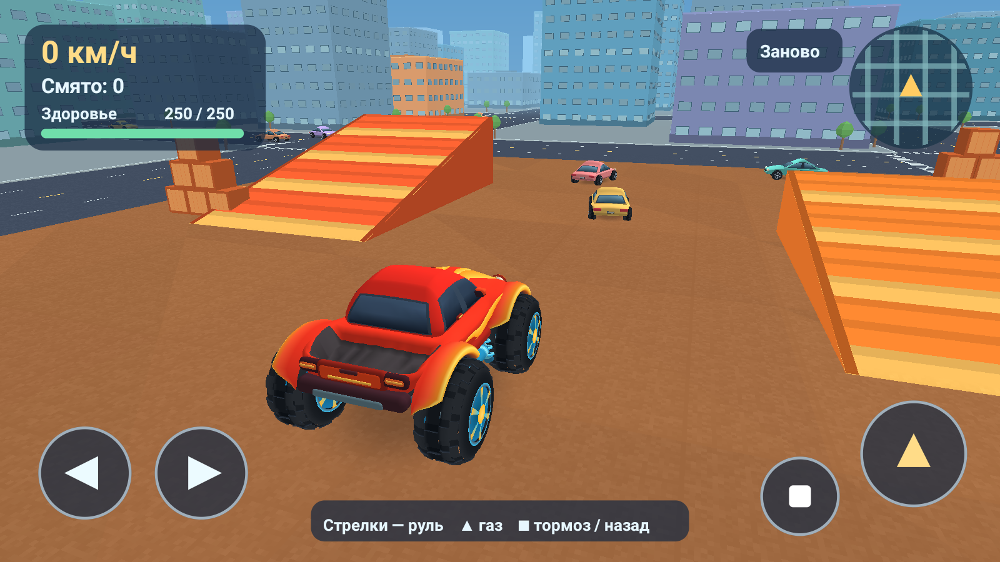
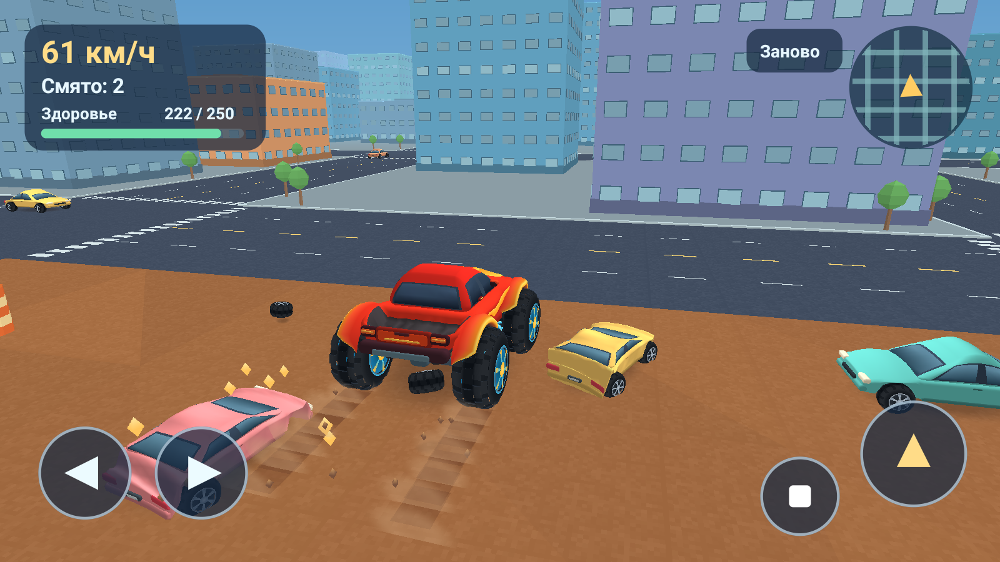

# Monster Truck: Город

Мультяшная 3D-игра для Android 9 (API 28) и новее. Управляйте монстртраком на тренировочной площадке и в городе с движущимся трафиком.

- У монстртрака 250 очков здоровья, у легковых машин — 100. Удары мнут кузов, а при сильных столкновениях колёса могут отрываться.
- Деревья можно сбивать. На грунте колёса поднимают пыль и оставляют следы, при заносах на асфальте появляется дым.

## Скриншоты

Ранние эскизы: [город](concept-city.png) · [столкновение](concept-crush.png).

## Сборка

Нужны JDK 17 или новее и Android SDK Platform 35. На Windows выполните `gradlew.bat :app:assembleDebug`, на Linux и macOS — `./gradlew :app:assembleDebug`. APK будет в `app/build/outputs/apk/debug/`.
